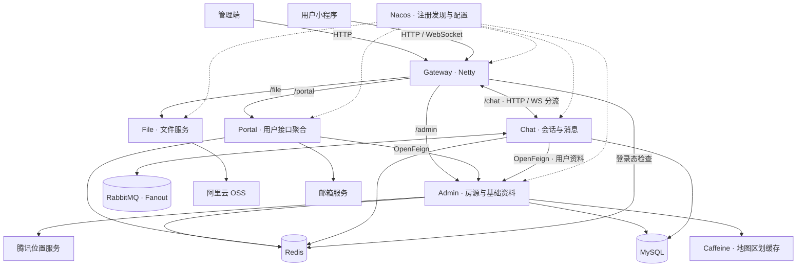

# 栖居租房 · zyh-house

基于 **Java 17、Spring Boot 和 Spring Cloud Alibaba** 的租房微服务后端，围绕「运营维护房源 → 用户筛选找房 → 查看详情 → 发起咨询」构建业务链路。


项目适合用于学习微服务职责划分、接口聚合、缓存、策略模式、WebSocket 通信和消息异步处理。本仓库包含后端与部分中间件部署配置；管理端和用户小程序是独立前端工程。

## 目录

- [项目功能](#项目功能)
- [系统架构](#系统架构)
- [技术栈](#技术栈)
- [工程结构](#工程结构)
- [实现要点](#实现要点)
- [开发环境](#开发环境)
- [本地运行](#本地运行)
- [接口与联调](#接口与联调)
- [测试](#测试)
- [常见问题](#常见问题)
- [后续计划](#后续计划)
- [参考资料](#参考资料)

## 项目功能

| 业务领域 | 当前能力 |
| --- | --- |
| 房源运营 | 房源新增与编辑、上架/下架/出租状态、标签与设施、城市与区域关联、出租到期扫描 |
| 用户找房 | 城市列表、筛选选项、区域/租金/户型等组合筛选、价格/距离排序、分页展示和详情查询 |
| 用户与配置 | 管理账号、租客/房东资料、邮箱验证码登录、微信登录接口、字典与系统参数 |
| 在线咨询 | 会话创建与查询、文本/图片/语音/卡片消息协议、历史记录、访问/已读状态、心跳与重连相关处理 |
| 地图与媒体 | 腾讯位置服务接入、OSS 代理上传、限时签名直传接口 |

配套前端分别为 Vue 3 + Element Plus 的管理端、uni-app + Vue 3 的用户小程序。前端职责主要是运营维护和找房咨询，通过统一网关访问后端；本仓库不包含它们的安装包和源码目录。

当前业务范围是房源信息与咨询，不包含订单支付、在线签约或完整租赁交易流程。邮箱和微信登录接口均存在，微信平台身份校验及权限控制仍需进一步完善。

## 系统架构



开发环境共享 MySQL 和 Redis，各服务按职责组织数据操作。公共模块是 Maven 依赖，不是独立的请求中转服务。`zyh-mstemplate` 为模板/示例模块，未画入核心业务链路。

**房源查询：** 小程序 → Gateway → Portal → Admin → 城市房源索引/详情缓存 → 筛选、排序和分页 → Portal 字典转换 → 返回页面数据。当前用户搜索先处理城市候选数据，再做内存分页；管理员列表使用 SQL 分页，两条路径不同。

**在线咨询：** 小程序 → WebSocket → Gateway → Chat → RabbitMQ → 在线转发与持久化消费者 → MySQL/Redis。转发和持久化是独立消费分支，客户端发送 API 成功不等于消息已落库或送达。

## 技术栈

主要版本以根目录 `pom.xml` 和实际运行配置为准。

| 技术 | 版本/组件 | 用途 |
| --- | --- | --- |
| Java | 17 | 后端语言与编译目标 |
| Spring Boot | 3.3.3 | 应用与自动配置 |
| Spring Cloud | 2023.0.3 | Gateway、OpenFeign、LoadBalancer |
| Spring Cloud Alibaba | 2023.0.1.2 | Nacos 注册发现与配置 |
| MyBatis-Plus | 3.5.7 | 常规 CRUD、分页与自定义 Mapper SQL |
| MySQL | Compose 示例 8.4.2 | 房源、账号、会话、消息等业务数据 |
| Redis / Redisson | Redis 示例 7.0.15 / Redisson 3.29.0 | 缓存、登录态、ZSet 与分布式锁 |
| Caffeine | 由模块依赖声明 | JVM 本地区划缓存 |
| RabbitMQ | Compose 示例 3.12.6-management | 聊天事件广播与异步消费 |
| WebSocket | Jakarta WebSocket | 双向连接、聊天帧与心跳 |
| JWT | JJWT | 配合 Redis 保存可撤销登录态 |
| 阿里云 OSS | OSS SDK | 媒体对象上传和签名策略 |
| 腾讯位置服务 / SMTP | 外部服务 | 地图能力与邮件验证码 |

Nacos Server 的 Compose 示例版本为 **2.2.2**。上表中的中间件版本描述仓库示例配置，不代表已经验证所有升级组合。

## 工程结构

```text
zyh-house
├── pom.xml                       # 父工程、依赖版本与模块管理
├── zyh-gateway                   # 统一入口、鉴权、HTTP/WS 路由
├── zyh-admin
│   ├── zyh-admin-api             # DTO/VO、Feign 契约
│   └── zyh-admin-service         # 房源、用户、字典、参数、地图
├── zyh-portal
│   ├── zyh-portal-api
│   └── zyh-portal-service        # 用户登录、城市、首页与详情聚合
├── zyh-chat
│   ├── zyh-chat-api
│   └── zyh-chat-service          # 会话、消息、WebSocket 与 MQ
├── zyh-file
│   └── zyh-file-service          # 上传与 OSS 接入
├── zyh-common
│   ├── zyh-common-core           # 工具、基础配置与分页类型
│   ├── zyh-common-domain         # 统一响应、常量与共享类型
│   ├── zyh-common-security       # Token、登录上下文与异常处理
│   ├── zyh-common-redis          # Redis 与 Redisson 封装
│   ├── zyh-common-cache          # Caffeine / Redis 缓存工具
│   ├── zyh-common-rabbitmq       # 消息组件
│   └── zyh-common-message        # 验证码与邮件能力
├── zyh-mstemplate                # 微服务模板与测试示例
└── deploy/dev                    # 中间件 Compose 与 Nacos SQL
```

核心表包括 `house`、`house_status`、`city_house`、`tag`、`tag_house`、`app_user`、`sys_user`、`session`、`message`、`sys_region`、`sys_argument`、`sys_dictionary_type`、`sys_dictionary_data`。

## 实现要点

- **服务分层与聚合：** Controller → Service → Mapper；Portal 使用 Feign 聚合 Admin 数据，并转换为用户展示 VO。
- **缓存与预热：** 地图区划使用 Caffeine + Redis；房源详情使用 Redis 旁路缓存，不存在的房源短期缓存空对象。缓存回源、失效和业务状态需分别考虑。
- **规则扩展：** 组合房源过滤器与排序策略工厂，按请求选择价格或距离排序。距离目前用于近似排序，不是精确的米制导航距离。
- **并行 I/O 聚合：** 城市资料通过 CompletableFuture 并行查询，减少独立调用的串行等待。
- **聊天职责拆分：** WebSocket 负责收帧与连接映射，RabbitMQ 分发转发和持久化任务，Redis ZSet 组织会话与消息查询。
- **接口容错：** 房源字典缺项保留正常列表和分页结果；公共 Servlet 异常处理器按应用类型条件装配。
- **网关兼容修复：** 排除传递 Servlet starter，保持 Gateway 使用 Netty；聊天 HTTP 与 WS 路由分开，旧连接关闭使用条件删除避免误移除新连接。

本项目已体现这些实现方式，但权限、消息确认、缓存恢复和多实例 ID 分配仍有改进空间；尚未给出经过容量压测验证的 QPS 或在线连接上限。

## 开发环境

准备 JDK 17、Maven（已有联调使用 3.8.5）、MySQL、Redis、RabbitMQ、Nacos，以及 IntelliJ IDEA 等 Java IDE。使用 Compose 时还需 Docker 与 Docker Compose。

```bash
git clone https://github.com/06caiwang/zyh-house.git
cd zyh-house
java -version
mvn -version
```

确认 Maven 使用的 Java 也是 17。开发环境配置来自各服务 `src/main/resources/bootstrap.yml` / `bootstrap.yaml` 与 Nacos，两者需要对齐。

## 本地运行

### 1. 准备中间件与业务库

`deploy/dev/app/docker-compose-mid.yml` 提供 MySQL、Nacos、Redis、RabbitMQ 的开发示例。先检查端口、挂载路径、账户和 Nacos 数据库连接，再启动：

```bash
docker compose -f deploy/dev/app/docker-compose-mid.yml up -d
```

该文件包含环境相关配置，应先按自己的环境调整。`deploy/dev/app/mysql/init/init.sql` 引用的是数据库用户与 **Nacos 元数据** 初始化脚本；`deploy/dev/sql/nacosdata.sql` 也是历史 Nacos 数据备份。

**当前仓库未提供完整的 13 张业务表 DDL 与业务字典/区划种子数据，启动业务服务前需准备已有业务库或补齐迁移脚本。** Nacos 数据库不能代替租房业务库；历史配置备份也应检查后再导入。房源搜索依赖城市房源缓存索引，单独插入 `house` 表并不会自动形成完整展示数据。

### 2. 对齐 Nacos 配置

开发环境设置 `RUN_ENV=dev`，在 Nacos 创建/使用命名空间，确保**命名空间 ID**与客户端一致，例如 `house-dev`；使用 `DEFAULT_GROUP`。

各服务需要配置 Nacos Config/Discovery 的 `server-addr`、`username`、`password`、`namespace`。可在 IDE 环境变量中覆盖，例如：

```text
RUN_ENV=dev
SPRING_CLOUD_NACOS_CONFIG_SERVER_ADDR=127.0.0.1:8848
SPRING_CLOUD_NACOS_DISCOVERY_SERVER_ADDR=127.0.0.1:8848
SPRING_CLOUD_NACOS_CONFIG_NAMESPACE=house-dev
SPRING_CLOUD_NACOS_DISCOVERY_NAMESPACE=house-dev
SPRING_CLOUD_NACOS_CONFIG_USERNAME=<your-nacos-user>
SPRING_CLOUD_NACOS_CONFIG_PASSWORD=<your-nacos-password>
SPRING_CLOUD_NACOS_DISCOVERY_USERNAME=<your-nacos-user>
SPRING_CLOUD_NACOS_DISCOVERY_PASSWORD=<your-nacos-password>
```

将占位符替换为自己的配置；不要把真实密码、SMTP 授权码或云访问密钥写入新的公开提交。Portal 当前 bootstrap 固定使用 `house-dev`，其他环境也应同步覆盖它的命名空间。

服务级配置按 `spring.application.name`、profile 和 `file-extension` 加载，例如 `zyh-gateway-dev.yaml`；也可能加载基础配置或历史无扩展名 Data ID，应以启动日志中实际加载的名称为准。默认规则可参考 [Nacos Config 官方说明](https://github.com/alibaba/spring-cloud-alibaba/wiki/Nacos-config)。

| 配置 | 主要内容 |
| --- | --- |
| `zyh-gateway-dev.yaml` | 端口、公开路径、服务路由；可参考仓库 `zyh-gateway/config/zyh-gateway-dev.yaml` |
| 各业务服务的配置 | `server.port`、模块功能开关、File 的 `storage.type` / `oss.*` 等 |
| `share-common-dev.yaml` | 公共应用配置，按引用服务准备 |
| `share-mysql-dev.yaml` | 数据源、业务库连接与 MyBatis 配置 |
| `share-redis-dev.yaml` | Redis/Redisson 连接与 `zyh.redis.enabled` |
| `share-rabbitmq-dev.yaml` | RabbitMQ 地址、账户、vhost 与监听配置 |
| `share-caffeine-dev.yaml` | 本地缓存配置 |
| `share-map-dev.yaml` | `map.type`、`qqmap.apiServer`、`qqmap.key` |
| `share-mail-dev.yaml` | `spring.mail.*`、邮件发送开关 |

共享配置按各服务 bootstrap 的 `shared-configs` 列表提供，并不是所有服务都引用全部配置。配置类与实际注入要求也应一起检查。

网关配置文件放在仓库 `config` 目录只是参考副本；复制到该目录不会自动更新 Nacos。邮件发送由 `zyh.send-message` 控制，默认关闭实际发送，真实邮箱验证需配置 SMTP 并完善验证码安全策略。

### 3. 编译并运行应用入口

在仓库根目录编译所有模块：

```bash
mvn -DskipTests compile
```

IDE 导入根 `pom.xml`，选择 JDK 17，为每个运行配置设置上述环境变量。先启动中间件，然后启动 Admin、File、Chat、Portal，最后启动 Gateway；检查 Nacos 服务注册及各服务启动日志。

| 服务 | 应用入口 | 联调端口约定 |
| --- | --- | --- |
| Admin | `com.zyh.adminservice.AdminServiceApplication` | 18081 |
| File | `com.zyh.fileservice.FileServiceApplication` | 18082 |
| Chat | `com.zyh.chatservice.ChatServiceApplication` | 18084 |
| Portal | `com.zyh.portalservice.PortalServiceApplication` | 18083 |
| Gateway | `com.zyh.gateway.GatewayApplication` | 18080 |

端口来自 Nacos 的 `server.port`，表格是联调约定，不是 Java 源码中的固定端口。模板模块可按需启动。

当前多数业务模块没有声明 Spring Boot `repackage` 执行，父 POM 还配置了 Maven install/deploy 的 skip。不要直接假设 `mvn package` 后所有 JAR 都能 `java -jar` 运行，或 `mvn install` 已安装全部内部依赖；这里优先使用完整 Reactor 编译和 IDE 应用入口。

### 4. 检查公开查询

```bash
curl -i "http://127.0.0.1:18080/portal/citypage/get/nologin"
```

Windows PowerShell 可使用 `curl.exe`。应用包装响应通常形如：

```json
{"code":200000,"msg":"操作成功","data":{}}
```

同时检查 HTTP 状态与业务码。部分 Admin 内部字典/参数契约返回原始对象，不能对所有接口都假设统一 `R<T>` 包装。

## 接口与联调

当前源码梳理包含 **60 个应用 HTTP 实现接口和 1 个 WebSocket 入口**，包含控制器继承 Feign 的映射；不含第三方接口、MQ 消费者或框架自动端点。

| 服务 | HTTP 数量 | 网关前缀 |
| --- | ---: | --- |
| Admin | 39 | `/admin` |
| Portal | 11 | `/portal` |
| Chat | 7 | `/chat` |
| File | 2 | `/file` |
| Mstemplate | 1 | `/mstemplate` |

代表性接口：

| 方法 | 网关路径 | 用途 |
| --- | --- | --- |
| GET | `/portal/citypage/get/nologin` | 城市列表 |
| POST | `/portal/homepage/pull_list/get/nologin` | 区域和字典筛选项 |
| POST | `/portal/homepage/house_list/search/nologin` | 房源搜索 |
| GET | `/portal/housepage/get/nologin?houseId=...` | 房源详情 |
| GET | `/portal/user/send_code?mail=...` | 请求邮箱验证码 |
| POST | `/portal/user/login/code` | 邮箱验证码登录 |
| POST | `/chat/session/add` | 创建双方会话 |
| POST | `/chat/session/list` | 用户会话列表 |
| POST | `/chat/message/list` | 会话历史 |
| POST | `/file/upload` | multipart `file` 上传 |
| GET | `/file/sign` | OSS 签名直传参数 |

受保护请求携带 `Authorization: Bearer <accessToken>`。Gateway 使用 `StripPrefix=1`，如 `/portal/...` 转发到 Portal 时去掉 `/portal`。具体字段、query/body 绑定和校验要求，以 Controller 与 Feign 契约为准。

### WebSocket 约定

```text
网关入口：ws://127.0.0.1:18080/chat/websocket
Chat 内部端点：/websocket
握手认证头：Authorization: Bearer <accessToken>
```

Nacos 网关路由应同时包含：

- `/chat/websocket` → `lb:ws://zyh-chat`，优先级 `order: -1`。
- 其余 `/chat/**` → `lb://zyh-chat`。

聊天帧外层为 `type` / `data`，`type=chat` 时 `data` 是消息 DTO 的 JSON **字符串**。Java Long ID 在 JavaScript 客户端保持十进制字符串，避免精度丢失。

微信小程序可通过 `uni.connectSocket` 配置握手头；浏览器原生 WebSocket API 不能以同样方式添加任意 Authorization 头，H5 需单独设计兼容认证。真机访问电脑服务时，`127.0.0.1` 指向手机自身，应使用可访问的电脑地址或符合微信配置的测试域名。

## 测试

已有回归测试覆盖字典完整/缺项/空列表/上游失败、Servlet/Reactive 异常装配、网关 Netty 选择、握手头兼容、失效身份与旧连接关闭竞态。

在根目录运行指定回归组，PowerShell 的 `-D` 参数建议加引号：

```bash
mvn -pl zyh-gateway -am "-Dtest=GatewayNettyRuntimeTest,GatewayExceptionHandlerContextTest" "-Dsurefire.failIfNoSpecifiedTests=false" test
mvn -pl zyh-chat/zyh-chat-service -am "-Dtest=WebSocketConfigTest,WebSocketServerTest" "-Dsurefire.failIfNoSpecifiedTests=false" test
mvn -pl zyh-portal/zyh-portal-service -am "-Dtest=HomePageServiceImplTest,ServletExceptionHandlerContextTest" "-Dsurefire.failIfNoSpecifiedTests=false" test
```

这些回归组此前共 16 项通过。历史实际联调验证了经网关 WS 101、心跳、认证拒绝和聊天 HTTP 查询；它们没有替代双用户消息投递/落库、消费者故障恢复、多实例或真机测试。仓库中另有 Redis 示例测试，运行全量测试前应检查是否依赖外部环境。

## 常见问题

| 现象 | 优先检查 |
| --- | --- |
| 服务启动缺配置或连不上 Nacos | `RUN_ENV`、命名空间 ID、Group、Data ID、地址、凭据及启动日志 |
| 小程序显示网络连接失败 | 网关是否监听、请求地址、开发工具域名设置、真机地址；再区分 HTTP 错误与业务错误 |
| WS 失败但 HTTP 正常 | Gateway 是否为 Netty、是否混入 Servlet starter、WS/HTTP 路由是否分开、Nacos 是否已发布最新配置、握手登录态 |
| 房源库有数据但列表为空 | 城市 ID、上架状态、`city_house` 与城市 Redis 索引、字典/区划数据；不要只检查 `house` 表 |
| 手动写 Redis 后应用仍读不到 | 核实实际注入 RedisTemplate 的 key/value serializer，JSON 业务内容与底层序列化是不同层 |
| 会话创建后列表没有它 | 当前用户会话排序缓存主要在消息写入后更新，还需检查历史与缓存恢复逻辑 |
| 搜索响应偶发很慢 | 分段记录 Portal Feign、Admin 城市索引/逐详情、字典、Redis/SQL等待；不要只凭总耗时认定排序是根因 |

## 后续计划

- 完善角色权限、资源归属、微信平台身份和验证码流程。
- 为房源多表维护补事务边界、缓存失效补偿与索引回源。
- 完善消息确认、固定持久化队列、异常重试/死信、幂等及缓存恢复。
- 分配唯一 Snowflake 节点标识，调整消息排序结构，避免 Long 转 ZSet double score 的精度问题。
- 将城市搜索和聊天历史改为有界查询，补充实际索引、链路追踪与隔离环境容量测试。
- 补齐业务数据库迁移、种子数据、脱敏配置模板与可重复部署说明。

性能结论应由固定部署、数据规模、缓存状态、并发、成功率和分位延迟支持；当前不宣称生产级权限完备、消息零丢失或万级在线容量。

## 参考资料

文档编排参考同类 GitHub 项目的功能、模块、架构与环境说明方式，内容依据本仓库实现整理：

- [macrozheng/mall](https://github.com/macrozheng/mall)
- [macrozheng/mall-swarm](https://github.com/macrozheng/mall-swarm)
- [Spring Cloud Alibaba：Nacos Config](https://github.com/alibaba/spring-cloud-alibaba/wiki/Nacos-config)

欢迎通过 [Issues](https://github.com/06caiwang/zyh-house/issues) 提交可复现的问题。请提供模块、环境、复现步骤及脱敏日志，避免上传令牌、密码、云密钥或个人聊天内容。
